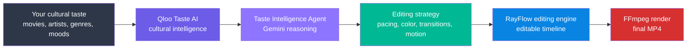
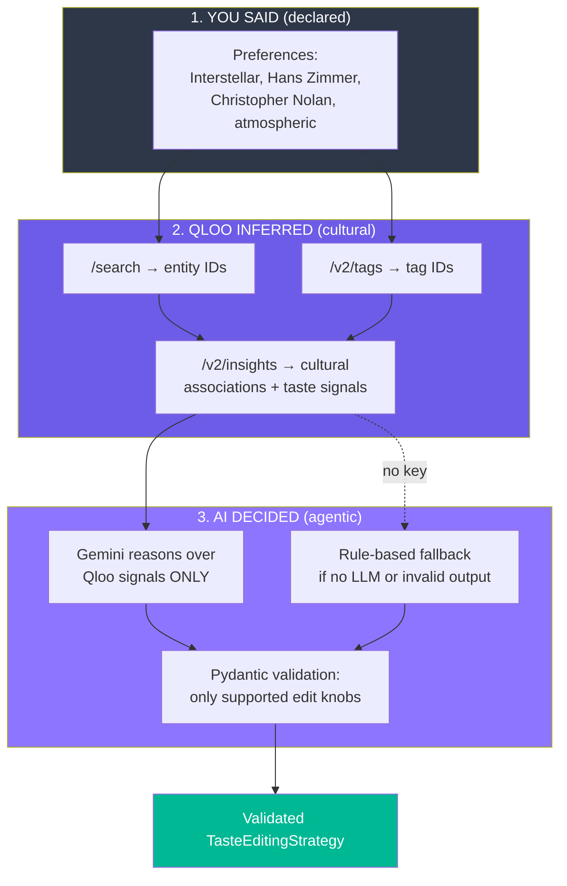
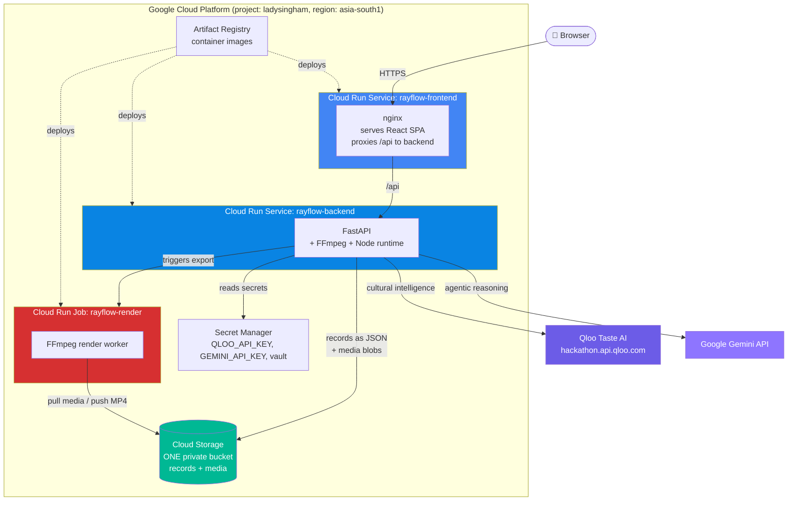
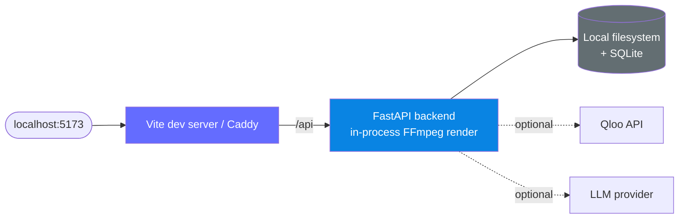
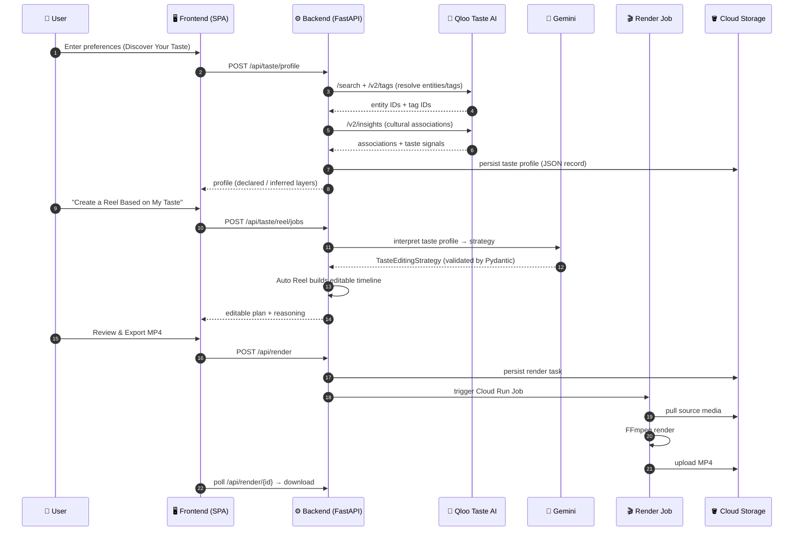
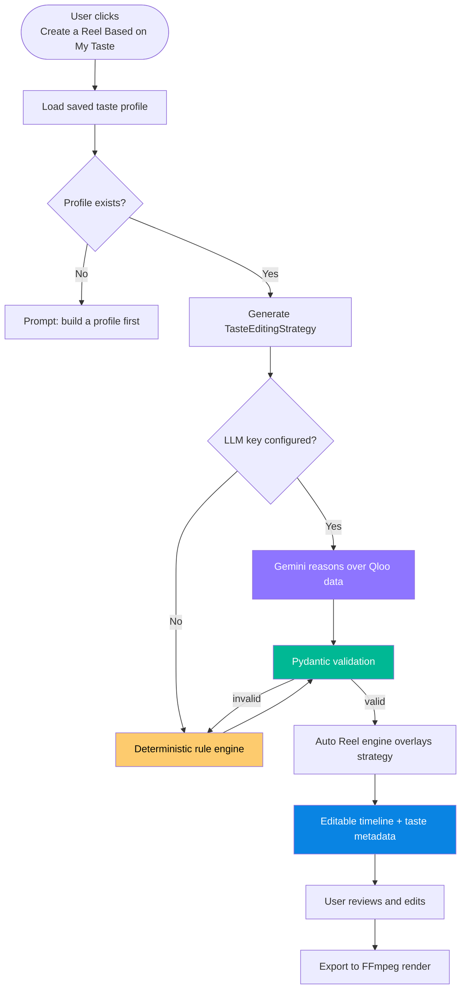
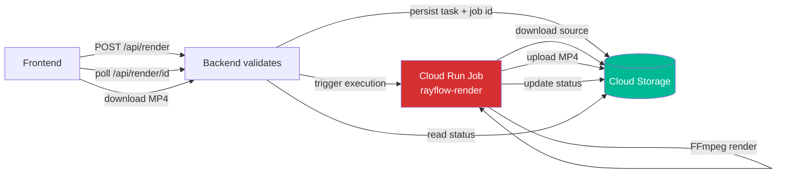
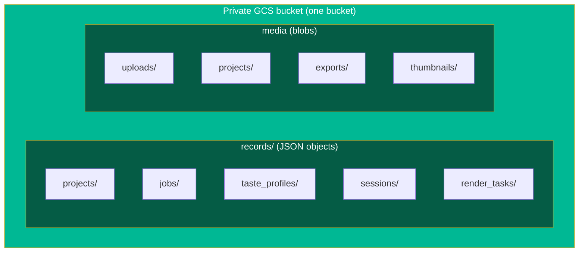

<div align="center">

# 🎬 RayFlow AI

### Video Editing That Understands Your Taste

**Your footage. Your preferences. Your creative direction.**

RayFlow AI is a **Qloo‑powered, agentic video‑editing studio**. It learns your cultural taste, reasons about it with an LLM, and turns it into **personalized — but fully editable — video edits**. It is an *editor*, not a text‑to‑video generator: every result is an editable timeline and a rendered MP4.


**🌐 Live demo:** https://rayflow-frontend-wd6lscqf3a-el.a.run.app

</div>

---

## 📖 Table of contents

- [What is RayFlow AI?](#-what-is-rayflow-ai)
- [The big idea: taste‑driven editing](#-the-big-idea-tastedriven-editing)
- [How the intelligence works](#-how-the-intelligence-works)
- [Feature overview](#-feature-overview)
- [System architecture](#-system-architecture)
- [The agentic taste loop (end‑to‑end)](#-the-agentic-taste-loop-endtoend)
- [Qloo integration](#-qloo-integration)
- [Request flow: creating a taste reel](#-request-flow-creating-a-taste-reel)
- [Rendering on Cloud Run Jobs](#-rendering-on-cloud-run-jobs)
- [Data model & storage](#-data-model--storage)
- [Tech stack](#-tech-stack)
- [Backend API reference](#-backend-api-reference)
- [Repository layout](#-repository-layout)
- [Run it locally](#-run-it-locally)
- [Deploy to Google Cloud Run](#-deploy-to-google-cloud-run)
- [Security & privacy](#-security--privacy)
- [Testing](#-testing)
- [Project status](#-project-status)
- [Further documentation](#-further-documentation)

---

## 🎯 What is RayFlow AI?

Traditional video editors give **every** user the same tools and the same default look. RayFlow asks a different question:

> *What if the editor adapted its creative decisions to **who you are**?*

You tell RayFlow what you love — films, directors, artists, genres, moods. RayFlow uses **Qloo's Taste AI** (a cultural‑intelligence knowledge graph) to understand the *cultural fabric* behind those preferences, then an **LLM agent** translates that understanding into concrete, supported editing choices: pacing, color mood, transitions, motion, and music direction.

The result is a **first draft that already feels like you** — and because it is a normal editable timeline, you stay in full control and can change anything before exporting.

**Core principle:** RayFlow *edits* video. It never fabricates footage. Qloo understands taste, the agent interprets taste, and RayFlow executes **real, supported editing operations** that you review and approve.

---

## 💡 The big idea: taste‑driven editing



Three distinct kinds of "intelligence" power this, and keeping them separate is a deliberate design choice:

| Layer | What it does | Powered by |
| --- | --- | --- |
| **Cultural intelligence** | Understands taste from your preferences | **Qloo Taste AI** (knowledge graph — *not* an LLM) |
| **Agentic interpretation** | Reasons over Qloo data → a validated editing strategy | **Google Gemini 2.5 Flash** (pluggable) |
| **Execution** | Builds an editable timeline and renders the video | **RayFlow engine + FFmpeg** |

---

## 🧠 How the intelligence works



Key guarantees:

- **Privacy‑first:** only cultural preference text (and derived Qloo IDs) is sent to Qloo. **Your photos, videos, and audio are never sent to Qloo.**
- **Grounded reasoning:** the LLM is instructed to reason *only* from the supplied Qloo data and never invent cultural facts.
- **Safe by construction:** the agent's output is validated against a strict Pydantic schema (`TasteEditingStrategy`) whose every field is constrained to values the renderer actually supports — the agent can never emit an arbitrary or unsafe operation.
- **Graceful degradation:** with no LLM key, a deterministic rule engine produces a valid strategy, and **manual editing + MP4 export work with no keys at all.**

---

## ✨ Feature overview

| Feature | Description |
| --- | --- |
| 🧭 **Discover Your Taste** | Enter preferences and see three clearly labeled layers: **YOU SAID** (declared), **QLOO INFERRED** (cultural associations + tag signals with affinity scores), **AI DECIDED** (the editing interpretation with written reasoning). |
| 🪄 **Create a Reel Based on My Taste** | A personalized Auto Reel that turns your taste profile into an editable draft (pacing, color, motion, transitions, beat sync). |
| 🎙️ **Taste‑aware AI Director** | Natural‑language edits like *"make it more cinematic"* use your taste signals. Every change is shown for **review & approval** before it is applied. |
| ✂️ **Manual editing** | Full timeline editing, trim, reorder, transitions, titles, color presets — **no API key required.** |
| 🎵 **Music & pacing** | Librosa performs real audio beat analysis and beat‑synced cuts. Qloo informs *preferences*, never analyzing uploaded audio. |
| 📝 **Captions** | Manual captions, plus optional local Faster‑Whisper speech‑to‑text. |
| 🎬 **Auto Reel templates** | Original templates preserved: Cinematic Story, Minimalist Clean, Fitness High Energy. |
| 📤 **MP4 export** | Rendered by FFmpeg — in‑process locally, via a Cloud Run Job in production. |

---

## 🏗️ System architecture

### Production (Google Cloud Run)



**Highlights**

- **No external database.** Persistence lives in a single private **Cloud Storage** bucket: records (projects, jobs, taste profiles) as JSON objects with atomic optimistic‑concurrency writes (GCS object generations); media/exports as blobs. No Supabase, no Cloud SQL.
- **Services are stateless.** The backend and render job do **not** share a filesystem; Cloud Storage is the handoff.
- **Secure by default.** Qloo/LLM keys live in Secret Manager; the private bucket uses uniform access + public‑access prevention; containers run as non‑root.

### Local development (Docker Compose)



Local mode needs no cloud: persistence is SQLite + filesystem, rendering runs in‑process, and manual editing/export work without any keys.

---

## 🔄 The agentic taste loop (end‑to‑end)



---

## 🧩 Qloo integration

RayFlow follows the [Qloo hackathon API](https://docs.qloo.com/reference/qloo-llm-hackathon-developer-guide) exactly.

| Aspect | Detail |
| --- | --- |
| Base URL | `https://hackathon.api.qloo.com` |
| Auth | `X-Api-Key` header (server‑side only) |
| Endpoints used | `GET /search` · `GET /v2/insights` · `GET /v2/tags` |
| Never used | `/recs`, `/recommendations` (legacy, unsupported) |
| Signals | `signal.interests.entities`, `signal.interests.tags`, `filter.type` |
| Robustness | retries + backoff, timeout handling, `403` (unsupported type) handled, empty results treated as "no data", private in‑memory caching |

**Backend module layout** (`backend/app/services/qloo/`):

| File | Responsibility |
| --- | --- |
| `client.py` | Secure transport: `X-Api-Key`, retries, error mapping; never leaks the key or upstream bodies |
| `entity_resolver.py` | Resolve declared preferences → Qloo entity IDs / tag IDs; report unresolved items |
| `taste_analyzer.py` | Retrieve cultural intelligence from `/v2/insights`; aggregate associations + tag signals |
| `profile_builder.py` | Assemble the normalized `TasteProfile` (declared / resolved / Qloo‑derived layers) |
| `cache.py` | Private TTL + LRU cache of Qloo responses |
| `schemas.py` | Normalized internal schemas with source‑entity references for auditability |

---

## 📡 Request flow: creating a taste reel



---

## 🎬 Rendering on Cloud Run Jobs

Long‑running FFmpeg work is kept off normal HTTP requests in production.



- Persistent job IDs and status that **survive instance restarts**.
- Cloud Run Job execution status is kept distinct from actual FFmpeg progress.
- The backend and worker never share a filesystem — Cloud Storage is the handoff.
- Locally, the same render code runs in‑process (no job needed).

---

## 🗃️ Data model & storage



- Every record is scoped to a workspace (`<collection>/<owner_id>/<id>.json`).
- Writes use GCS object **generation preconditions** for atomic compare‑and‑set (optimistic concurrency) — no database required.
- Local/dev uses SQLite + filesystem with identical semantics.

---

## 🛠️ Tech stack

| Layer | Technologies |
| --- | --- |
| **Frontend** | React 19, TypeScript, Vite, Tailwind CSS (hash‑router SPA) |
| **Backend** | Python, FastAPI, Pydantic; Node.js editor runtime worker |
| **Media** | FFmpeg + FFprobe (render/probe), Librosa (beat analysis), Faster‑Whisper (optional captions) |
| **Cultural AI** | Qloo Taste AI |
| **Agentic AI** | Google Gemini 2.5 Flash (pluggable: OpenAI, Anthropic, OpenRouter, Agent Router, Ollama) |
| **Infra** | Docker (multi‑stage, non‑root), Google Cloud Run (Services + Jobs), Cloud Storage, Secret Manager, Artifact Registry, Cloud Build |

---

## 📡 Backend API reference

All taste routes are workspace‑scoped and require a session.

| Method | Route | Purpose |
| --- | --- | --- |
| `GET` | `/api/taste/profile` | Fetch the saved taste profile + summary |
| `POST` | `/api/taste/profile` | Build and save a profile from preferences |
| `PUT` | `/api/taste/profile` | Update the saved profile |
| `POST` | `/api/taste/analyze` | Resolve + analyze without persisting (preview) |
| `POST` | `/api/taste/edit-plan` | Generate a validated taste editing strategy |
| `POST` | `/api/taste/apply` | Return a taste‑adjusted plan for review (not auto‑applied) |
| `POST` | `/api/taste/reel/jobs` | Start an async "reel based on my taste" job |
| `GET` | `/api/health` · `/api/ready` | Liveness / readiness (storage, ffmpeg, ffprobe, vault) |
| `POST` | `/api/render` · `GET /api/render/{id}` | Start a render / poll status |
| `POST` | `/api/ai/plan` · `/api/ai/apply` | Taste‑aware AI Director (propose / apply with approval) |

---

## 📂 Repository layout

```
Rayflowai/
├── backend/
│   ├── app/
│   │   ├── api/                 # FastAPI routes (incl. taste_routes.py)
│   │   ├── services/
│   │   │   ├── qloo/            # Qloo integration layer
│   │   │   │   ├── client.py
│   │   │   │   ├── entity_resolver.py
│   │   │   │   ├── taste_analyzer.py
│   │   │   │   ├── profile_builder.py
│   │   │   │   └── cache.py
│   │   │   ├── taste_intelligence.py   # agent: Qloo → Gemini → strategy
│   │   │   ├── taste_reel.py           # apply strategy to Auto Reel
│   │   │   ├── auto_edit.py            # existing Auto Reel engine
│   │   │   ├── ai_editing.py           # AI Director (taste-aware)
│   │   │   └── video_renderer.py       # FFmpeg render pipeline
│   │   ├── editor/
│   │   │   ├── store.py         # records + blobs (GCS / Supabase / SQLite)
│   │   │   └── gcs.py           # Cloud Storage backend
│   │   ├── worker/render_job.py # Cloud Run Job entrypoint
│   │   └── schemas/taste.py     # TasteEditingStrategy (validated)
│   ├── Dockerfile               # backend service image
│   └── Dockerfile.worker        # render-worker (Cloud Run Job) image
├── frontend/
│   ├── src/pages/TastePage.tsx  # "Discover Your Taste" UI
│   ├── src/pages/StudioPage.tsx # Studio + taste Auto Reel toggle
│   ├── src/services/api.ts      # taste API client
│   └── Dockerfile.cloudrun      # nginx SPA + /api proxy image
├── deploy/cloudrun/nginx.conf.template
├── cloudbuild.yaml              # 3 images → push → deploy services + job
├── QLOO_INTEGRATION.md
├── GCP_CLOUD_RUN_DEPLOYMENT.md
├── SECURITY.md
└── IMPLEMENTATION_REPORT.md
```

---

## 💻 Run it locally

**Prerequisites:** Node.js 24, Python 3.11+ (3.12 works), FFmpeg + FFprobe on `PATH`.

```bash
# 1. Backend
python -m venv backend/venv
backend/venv/Scripts/python -m pip install -r backend/requirements.txt -c backend/constraints.txt   # Windows
# (macOS/Linux: backend/venv/bin/python -m pip install ...)

# 2. Config
cp .env.example backend/.env
cp frontend/.env.example frontend/.env.local

# 3. Frontend deps
npm --prefix frontend ci
npm --prefix backend/editor-runtime ci

# 4. Run backend (terminal 1)
backend/venv/Scripts/python -m uvicorn app.main:app --app-dir backend --host 127.0.0.1 --port 8000

# 5. Run frontend (terminal 2)
npm --prefix frontend run dev -- --host 127.0.0.1 --port 5173 --strictPort
```

Open **http://127.0.0.1:5173/#/studio**. Manual editing and MP4 export work immediately.

**Enable taste features locally** — add to `backend/.env`:

```dotenv
QLOO_API_KEY=your_hackathon_key
GEMINI_API_KEY=your_gemini_key      # optional; enables LLM taste interpretation
GEMINI_MODEL=gemini-2.5-flash
AI_PROVIDER=gemini
```

**Or with Docker Compose:**

```bash
docker compose build    # builds frontend, backend, and render-worker images
docker compose up -d
docker compose ps
docker compose logs -f
```

---

## ☁️ Deploy to Google Cloud Run

Full step‑by‑step: **[GCP_CLOUD_RUN_DEPLOYMENT.md](GCP_CLOUD_RUN_DEPLOYMENT.md)**. Summary:

```bash
export PROJECT_ID=ladysingham REGION=asia-south1 REPO=rayflow PROJECT_NUMBER=434846178878
gcloud config set project "$PROJECT_ID"

# Enable APIs
gcloud services enable run.googleapis.com cloudbuild.googleapis.com \
  artifactregistry.googleapis.com secretmanager.googleapis.com storage.googleapis.com

# Artifact Registry + private GCS bucket (records + media)
gcloud artifacts repositories create "$REPO" --repository-format=docker --location="$REGION"
gcloud storage buckets create gs://rayflow-storage-ladysingham --location="$REGION" \
  --uniform-bucket-level-access --public-access-prevention

# Secrets (only two required; Gemini optional)
printf '%s' 'YOUR_QLOO_KEY' | gcloud secrets create QLOO_API_KEY --data-file=-
python3 -c "import secrets;print(secrets.token_urlsafe(48))" | gcloud secrets create RAYFLOW_VAULT_SECRET --data-file=-

# Build 3 images, push, and deploy both services + the render job
gcloud builds submit --config cloudbuild.yaml \
  --substitutions=_REGION="$REGION",_REPO="$REPO",_GCS_BUCKET=rayflow-storage-ladysingham,SHORT_SHA="$(git rev-parse --short HEAD)"

# Get the live URL
gcloud run services describe rayflow-frontend --region="$REGION" --format='value(status.url)'
```

> IAM note: the runtime service account needs `secretmanager.secretAccessor`, `storage.objectAdmin`, and `run.developer`; the build account needs `run.admin`, `artifactregistry.writer`, and `iam.serviceAccountUser` (including `actAs` on the runtime SA). See the deploy doc for the exact grants.

**Enable Gemini on a deployed backend (optional):**

```bash
printf '%s' 'YOUR_GEMINI_KEY' | gcloud secrets create GEMINI_API_KEY --data-file=-
gcloud secrets add-iam-policy-binding GEMINI_API_KEY \
  --member="serviceAccount:${PROJECT_NUMBER}-compute@developer.gserviceaccount.com" \
  --role="roles/secretmanager.secretAccessor"
gcloud run services update rayflow-backend --region="$REGION" \
  --update-secrets=GEMINI_API_KEY=GEMINI_API_KEY:latest \
  --update-env-vars=GEMINI_MODEL=gemini-2.5-flash,AI_PROVIDER=gemini
```

---

## 🔐 Security & privacy

- **Qloo and LLM keys are backend‑only** — never in frontend code or the built bundle; stored in Secret Manager in production.
- **User media is never sent to Qloo** — only declared cultural preference text and derived Qloo IDs.
- **AI output is validated** against strict Pydantic schemas constrained to supported editing operations; no arbitrary or shell operations are possible, and the Director's taste context is server‑populated (not client‑spoofable).
- **Approval preserved** — taste‑aware Director edits and taste "apply" return a proposed plan for review; nothing is applied without explicit user approval.
- Non‑root containers, private GCS bucket (uniform access + public‑access prevention), workspace isolation, per‑workspace rate limiting, origin checks, and encrypted per‑workspace provider credentials.

See **[SECURITY.md](SECURITY.md)** for the full review.

---

## 🧪 Testing

```bash
# Offline (mocked Qloo) — no key needed
backend/venv/Scripts/python -m pytest tests/test_qloo_client.py tests/test_taste_intelligence.py \
  tests/test_taste_routes.py tests/test_gcs_store.py

# Live Qloo integration — runs only when a real key is present (never faked)
QLOO_API_KEY=your_key backend/venv/Scripts/python -m pytest tests/test_qloo_live_integration.py -v
```

- **69 automated tests** covering the Qloo client, entity/profile/strategy logic, taste routes (full FastAPI stack with mocked Qloo), and the GCS record store (compare‑and‑set, isolation, one‑shot tickets).
- Real‑Qloo integration tests are **gated** on `QLOO_API_KEY` — a mocked test is never reported as a live pass.

---

## 📊 Project status

| Component | Status |
| --- | --- |
| Frontend (Cloud Run) | ✅ Deployed & public |
| Backend (Cloud Run) | ✅ Healthy — `ready` (storage, ffmpeg, ffprobe, vault, GCS, editor runtime) |
| GCS persistence (no DB) | ✅ Working |
| Qloo cultural intelligence | ✅ Live |
| Gemini agentic interpretation | ✅ Live (`gemini-2.5-flash`) |
| Taste profiles · taste Auto Reel · taste AI Director | ✅ Implemented |
| Manual editing + MP4 export (no keys) | ✅ Preserved |
| Render Cloud Run Job | ✅ Deployed |

**Live:** https://rayflow-frontend-wd6lscqf3a-el.a.run.app · **GCP:** project `ladysingham`, region `asia-south1`.

---

## 📚 Further documentation

| Document | Contents |
| --- | --- |
| [QLOO_INTEGRATION.md](QLOO_INTEGRATION.md) | Qloo architecture, API usage, taste agent, privacy, tests |
| [GCP_CLOUD_RUN_DEPLOYMENT.md](GCP_CLOUD_RUN_DEPLOYMENT.md) | Full Cloud Run deployment guide (APIs, IAM, secrets, build) |
| [SECURITY.md](SECURITY.md) | Security & privacy review |
| [IMPLEMENTATION_REPORT.md](IMPLEMENTATION_REPORT.md) | What was built, files, test results, status |

---

<div align="center">

**RayFlow AI** — *Qloo understands taste · the agent interprets it · RayFlow executes the edit.*

Built on the existing RayFlow editing engine. Powered by Qloo Taste AI + Google Gemini on Google Cloud Run.

</div>
