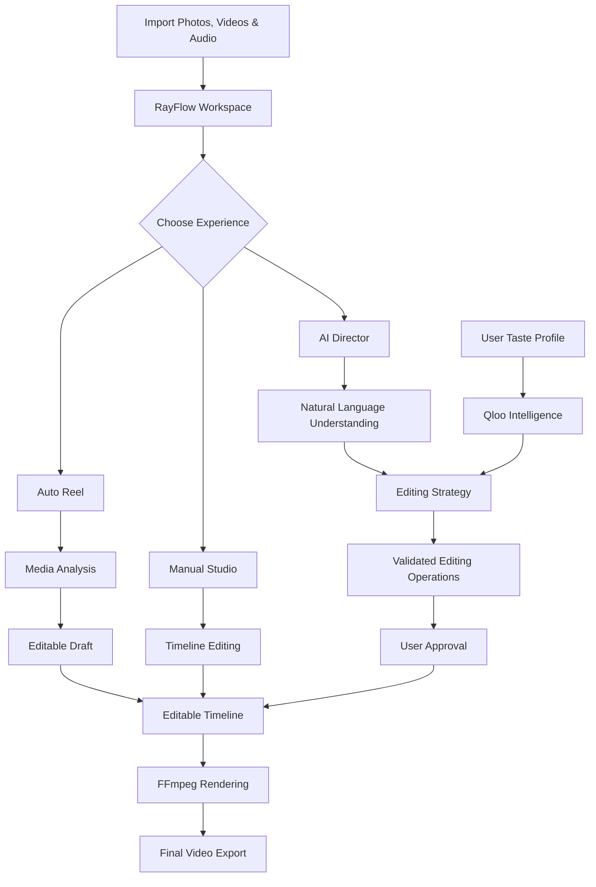
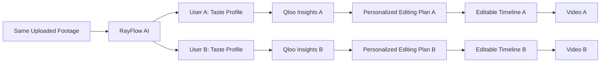
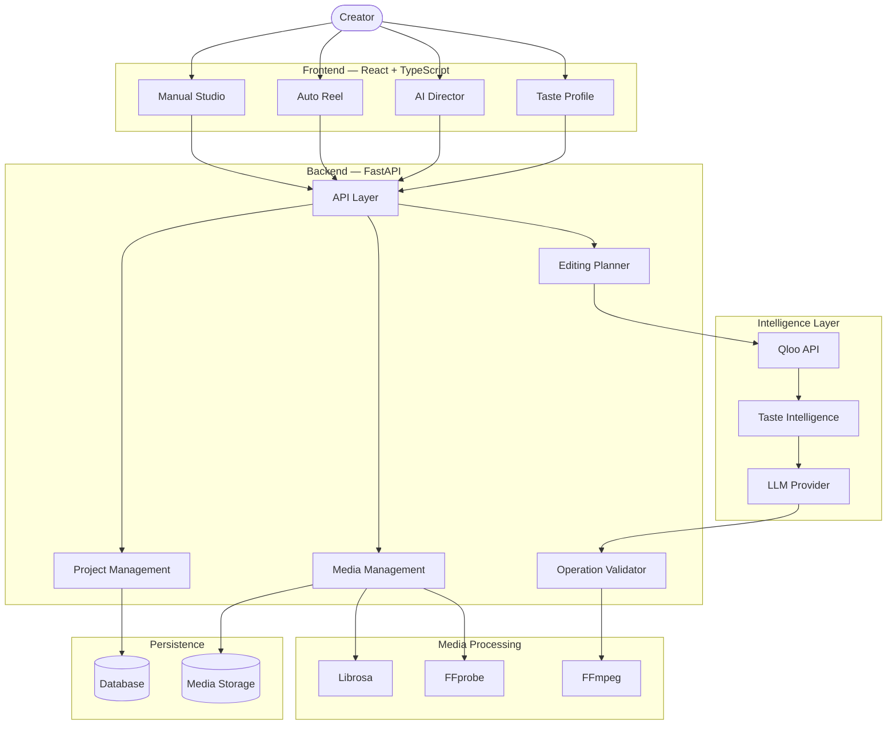
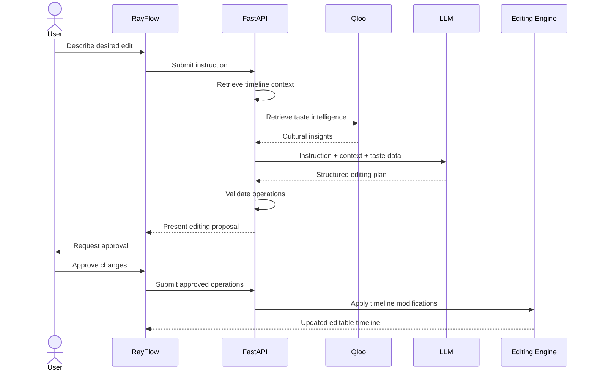
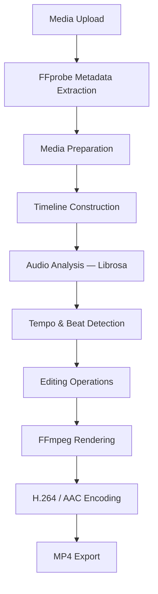
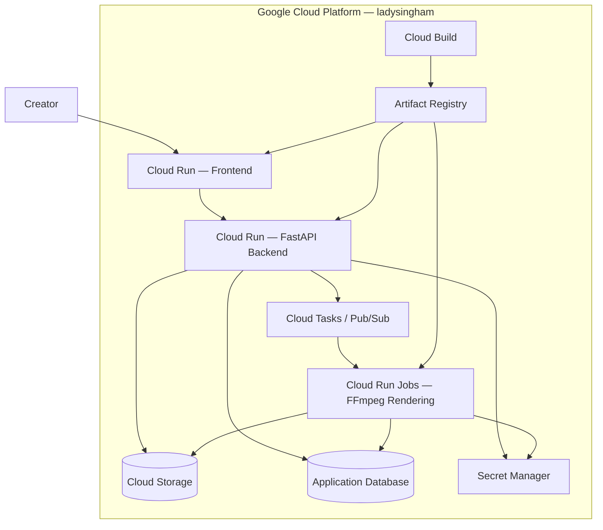
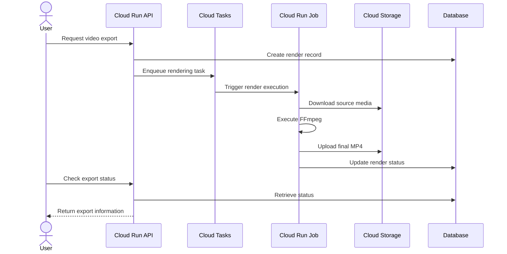

<div align="center">

# 🎬 RayFlow AI

### Video Editing That Understands Your Taste.

**Your footage. Your preferences. Your creative direction.**

An AI-assisted video editing platform that combines intelligent editing workflows, cultural taste intelligence, and natural-language creative direction to transform how people create videos.

<br/>


<br/>

[GitHub Repository](https://github.com/wildstar1965/Rayflowai) · [Report Bug](https://github.com/wildstar1965/Rayflowai/issues) · [Request Feature](https://github.com/wildstar1965/Rayflowai/issues)

</div>

---

## ✦ What is RayFlow?

Video editing shouldn't require hours of manually arranging clips, adjusting transitions, synchronizing music, and experimenting with visual styles.

RayFlow reimagines video editing through an intelligent creative assistant.

Instead of simply responding to editing instructions, RayFlow understands the user's creative intent, analyses the available editing context, and helps construct an editable timeline.

With cultural intelligence powered by **Qloo**, RayFlow aims to go beyond generic editing recommendations and create editing experiences influenced by individual taste.

**The same footage shouldn't have to produce the same video.**

---

## ✦ The Experience

<div align="center">

### Three Ways to Create

</div>

| 🎞️ Manual Studio                                      | ⚡ Auto Reel                                             | 🎬 AI Director                                            |
| ------------------------------------------------------ | ------------------------------------------------------- | --------------------------------------------------------- |
| Full creative control through an interactive timeline. | Turn existing photos and videos into an editable draft. | Describe what you want in natural language.               |
| Trim, reorder, arrange, synchronize and customize.     | Intelligent sequencing, pacing and transitions.         | Propose and modify editing operations with user approval. |

### 🧠 Taste-Aware Editing

RayFlow introduces cultural intelligence into video editing.

Users can build a taste profile from their favourite movies, directors, musicians and other cultural interests.

Qloo provides cultural insights, while the AI reasoning layer translates those insights into creative editing decisions.

The result is an editing experience that can adapt to individual preferences.

---

## ✦ How It Works



---

## ✦ What Makes RayFlow Different?

Most editing workflows focus on executing instructions.

RayFlow aims to understand the person behind those instructions.

Imagine two users uploading the exact same footage.

Both request:

*"Create a cinematic reel."*

However, their cultural preferences are different.

One prefers atmospheric science-fiction storytelling, while another prefers energetic action sequences.

RayFlow uses cultural intelligence to influence the editing strategy.



**Different tastes. Different editing decisions. Different creative outcomes.**

---

## ✦ System Architecture

RayFlow follows a modular architecture that separates the frontend, AI intelligence, backend services, and media-processing engine.



### Architecture Principles

| Principle                            | Implementation                                                           |
| ------------------------------------ | ------------------------------------------------------------------------ |
| AI-assisted, deterministic execution | AI generates structured operations; backend validates and executes them. |
| Modular intelligence                 | Cultural intelligence and LLM reasoning remain separate.                 |
| User-controlled editing              | AI-generated changes require approval.                                   |
| Independent media engine             | FFmpeg handles actual video processing.                                  |
| Graceful degradation                 | Manual editing remains available without external AI credentials.        |

---

## ✦ Intelligence Architecture

### Qloo + LLM + RayFlow

Qloo is not an LLM provider. It provides cultural intelligence that can enrich the reasoning process.

| Component               | Responsibility                                           |
| ----------------------- | -------------------------------------------------------- |
| Qloo                    | Cultural entities, taste relationships and insights.     |
| Gemini / Configured LLM | Understands instructions and creates editing strategies. |
| RayFlow                 | Converts strategies into supported timeline operations.  |
| Librosa                 | Analyses audio and detects beats.                        |
| FFmpeg                  | Executes video rendering.                                |

### AI Director Execution Flow



### Deterministic Editing Pipeline

AI should never directly execute arbitrary commands.

```text
Natural Language Instruction
             |
             v
      LLM Reasoning
             |
             v
    Structured JSON Plan
             |
             v
     Schema Validation
             |
             v
    Approved Operations
             |
             v
     Editing Engine
             |
             v
        FFmpeg
             |
             v
      Final Render
```

---

## ✦ Video Processing Engine

RayFlow uses established media-processing tools instead of relying on an LLM to perform signal processing or video rendering.



**FFmpeg**

* Video and audio encoding.
* Clip concatenation.
* Transitions and effects.
* Resolution and frame-rate handling.
* Final video rendering.

**FFprobe**

* Media metadata extraction.
* Duration and resolution detection.
* Audio and video stream inspection.

**Librosa**

* Tempo estimation.
* Beat detection.
* Audio feature extraction.
* Music synchronization support.

---

## ✦ Technology Stack

<div align="center">

| Layer                 | Technologies                     |
| :-------------------- | :------------------------------- |
| Frontend              | React 19, TypeScript, Vite       |
| Backend               | Python, FastAPI                  |
| AI Reasoning          | Gemini / Configured LLM Provider |
| Cultural Intelligence | Qloo API                         |
| Media Processing      | FFmpeg, FFprobe                  |
| Audio Analysis        | Librosa                          |
| Database              | Existing application database    |
| ORM                   | Prisma, where applicable         |
| Containerization      | Docker, Docker Compose           |
| Reverse Proxy         | Caddy                            |
| Cloud Infrastructure  | Google Cloud Platform            |
| Application Hosting   | Google Cloud Run                 |
| Rendering             | Google Cloud Run Jobs            |
| Object Storage        | Google Cloud Storage             |
| Secrets               | Google Secret Manager            |

</div>

---

## ✦ Cloud Infrastructure

RayFlow's target production deployment uses Google Cloud's managed infrastructure.



### Why Cloud Run?

* Managed container deployment.
* Automatic scaling.
* Independent frontend and backend services.
* Separate rendering workloads.
* Integration with Google Cloud Storage.
* Centralized secret management.
* No requirement to manage virtual machines.

### Rendering Lifecycle



**Production region:** `asia-south1`
**GCP Project ID:** `ladysingham`

---

## ✦ Getting Started

### Prerequisites

* Node.js
* npm
* Python 3.12+
* FFmpeg and FFprobe
* Git
* Docker (optional)

### Clone the Repository

```bash
git clone https://github.com/wildstar1965/Rayflowai.git

cd Rayflowai
```

### Frontend Setup

```bash
cd frontend

npm install

npm run dev
```

### Backend Setup

```bash
cd backend

python -m venv venv
```

Activate the environment:

```bash
# Windows
venv\Scripts\activate

# Linux / macOS
source venv/bin/activate
```

Install dependencies:

```bash
pip install -r requirements.txt
```

Start the backend using the configured FastAPI entry point:

```bash
uvicorn app.main:app --reload --port 8000
```

### Docker Setup

From the repository root:

```bash
docker compose build

docker compose up -d
```

Stop:

```bash
docker compose down
```

*Use the actual backend module path and configured frontend scripts from the repository.*

---

## ✦ Environment Configuration

Create a local `.env` file using `.env.example`.

```env
# Application
APP_ENV=development

# AI Provider
LLM_PROVIDER=
GEMINI_API_KEY=

# Qloo
QLOO_API_URL=https://hackathon.api.qloo.com
QLOO_API_KEY=

# Database
DATABASE_URL=

# Google Cloud
GCP_PROJECT_ID=ladysingham
GCP_PROJECT_NUMBER=434846178878
GCP_REGION=asia-south1

# Storage
GCS_BUCKET_NAME=
```

> Never commit actual API keys, database passwords, service account private keys, or other credentials. Use Google Secret Manager for production secrets.

---

## ✦ Privacy & Security

RayFlow is designed around controlled media handling and deterministic execution.

* API credentials remain on the backend.
* AI-generated operations are validated before execution.
* External AI services receive only the context required for their task.
* Media storage and access should follow project-level authorization.
* Temporary rendering files should be cleaned up according to retention policies.
* Production credentials are managed through Secret Manager.
* Core manual editing should not depend on external AI availability.

---

## ✦ Roadmap

* [x] React-based editing workspace
* [x] Timeline-based editing capabilities
* [x] FFmpeg rendering pipeline
* [x] Audio analysis with Librosa
* [x] Core Auto Reel and AI Director workflows
* [ ] Qloo cultural intelligence integration
* [ ] Personalized taste profiles
* [ ] Taste-aware Auto Reel
* [ ] Taste-aware AI Director
* [ ] Advanced personalized editing strategies
* [ ] Production Cloud Run deployment
* [ ] Asynchronous cloud rendering
* [ ] Production-grade storage and job management

*Update completion status as each feature is verified.*

---

<div align="center">

## Built for Creators. Designed Around Taste.

**RayFlow AI**

*Your Footage. Your Taste. Your Story.*

<br/>

[GitHub](https://github.com/wildstar1965/Rayflowai)

</div>
